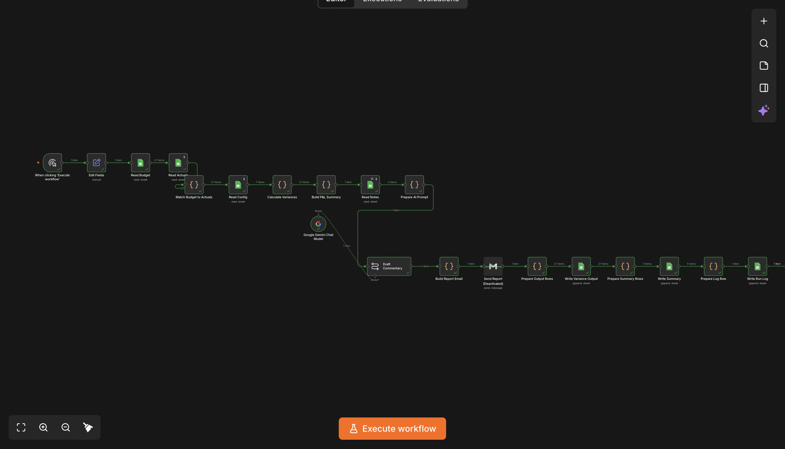
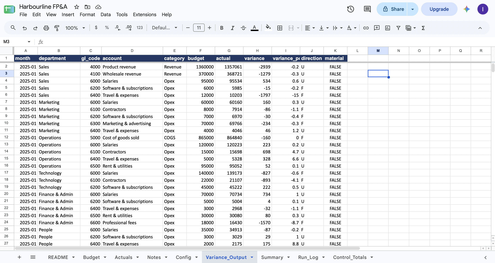
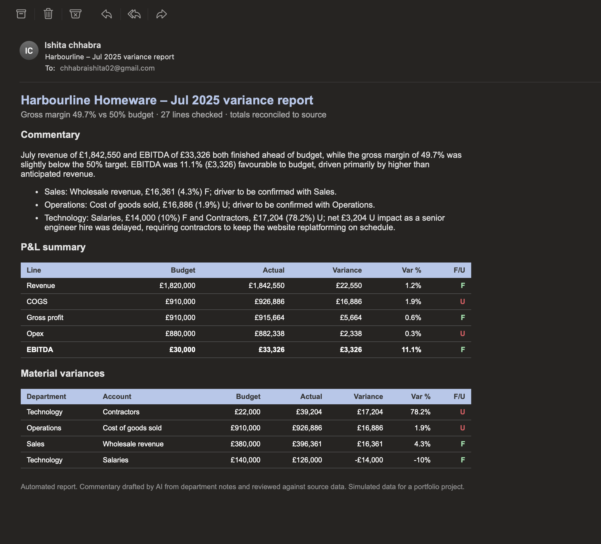
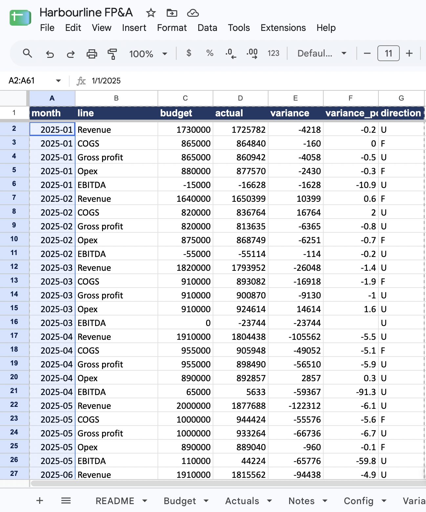

# Harbourline FP&A: Automated Budget vs Actual Variance Reporter

An n8n workflow that turns monthly budget and actuals data into a management variance report, with flagged variances, a P&L roll-up to EBITDA, reconciliation checks and AI-drafted commentary. It runs end to end with no manual steps.

> **Note:** Harbourline Homeware Ltd is a fictional UK retailer. All data is synthetic and was generated for this project.

## The problem

Every month, FP&A teams compare actuals to budget in spreadsheets, decide which variances matter, chase departments for explanations and write commentary. The work is repetitive, easy to get wrong and slow to turn around. This workflow automates the mechanical parts and leaves the analyst to review and add judgement.

## What it does

1. Reads budget, actuals, department notes and thresholds from Google Sheets
2. Matches budget to actuals by month, department and GL account
3. Calculates variance (Actual − Budget) in £ and %, and flags each line **F** (favourable) or **U** (unfavourable). Revenue above budget is F; costs above budget are U
4. Applies a materiality rule so only variances that need explaining are flagged
5. Rolls up to Revenue, COGS, Gross Profit, Opex and EBITDA
6. Runs reconciliation and data-completeness checks
7. Drafts management commentary with an LLM (Gemini), grounded only in the department notes
8. Emails an HTML report, and writes results and a run log back to Google Sheets

## Screenshots

| Workflow | Output |
|---|---|
|  |  |
|  |  |

## Key logic

- **Variance:** Actual − Budget. Variance % = Variance / |Budget|
- **Favourable / Unfavourable:** depends on line type. Revenue above budget is F; cost above budget is U
- **Materiality:** a line is flagged if |variance| ≥ £10,000, or if |variance %| ≥ 5% and |variance| ≥ £2,000. Thresholds live in a Config tab, so finance can change them without touching the workflow
- **Controls:** report totals reconcile back to source data, and the run stops if data is missing for the month
- **AI guardrail:** the model may only use drivers stated in the department notes. Where there is no note, it writes "Driver to be confirmed with [department]" instead of inventing a reason

## Data

27 P&L lines across 5 departments for 12 months of FY2025 (324 budget rows and 324 actual rows), with department notes and planted variance stories for testing. See `Harbourline_FPA_Data.xlsx`.

## Tech stack

n8n · Google Sheets · Gmail · Google Gemini API · JavaScript (Code nodes)

## How to run it

1. Install n8n (`npx n8n`) and open http://localhost:5678
2. Import `workflow.json` (workflow menu → Import from file, or paste into the canvas)
3. Upload `Harbourline_FPA_Data.xlsx` to Google Sheets
4. Create credentials in n8n for Google Sheets, Gmail and Google Gemini, and point the Sheets nodes at your copy
5. Set `report_month` in the first Edit Fields node (for example `2025-09`) and execute

## Limitations and next steps

- Data is synthetic, so commentary quality depends on the notes provided
- Runs on a manual trigger; a monthly Schedule Trigger and an error-alert workflow are the next additions
- A Looker Studio dashboard on the output tab is planned
